<div align="center">


<br/>

<!-- identity -->


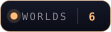

<br/>

<!-- stack -->
<a href="https://www.typescriptlang.org"></a>
<a href="https://vite.dev"></a>
<a href="https://gsap.com"></a>
<a href="https://lenis.darkroom.engineering"></a>

<br/>

<!-- approach -->


<br/>

<!-- platform -->


<br/><br/>

*One app, six worlds. A night-sky launcher for six coding puzzle games, built as a phone app first and a portfolio showpiece second.*

<br/>

[Overview](#overview) · [Features](#features) · [The six worlds](#the-six-worlds) · [Architecture](#architecture) · [App icons](#app-icons) · [Launch flow](#launch-flow) · [Layout](#layout) · [Design system](#design-system) · [Motion](#motion) · [Getting started](#getting-started) · [Deployment](#deployment) · [Licenses](#licenses)

</div>

---

<a id="overview"></a>
##  Overview

**The Lumenari System** is the home page and launcher for six coding puzzle journeys, one for each of six languages. It is designed as a single app: open it on a phone and it behaves like a home screen with six games inside it. Open it on a desktop and it becomes a portfolio-grade showcase of the same material.

| World | Language | Link |
|---|---|---|
| **Noctiluca** | Python | `hassanireza.github.io/noctiluca/` |
| **Aurora** | CSS | `hassanireza.github.io/aurora/` |
| **Vespera** | HTML | `hassanireza.github.io/vespera/` |
| **Stellara** | JavaScript | `hassanireza.github.io/stellara/` |
| **Lunara** | React | `hassanireza.github.io/lunara/` |
| **Eclipsa** | Django | `hassanireza.github.io/eclipsa/` |

The page has six sections that share one night-sky backdrop:

1. **Launch screen.** The mark appears, six dots ignite in the world colours, and a curtain lifts. Shown once per session.
2. **Sky.** A large Fraunces title and an orbit of the six app icons around a gold star.
3. **Home screen.** The six icons on a glass panel. A tap launches the world like opening an app.
4. **Worlds.** A full-bleed carousel of six posters. The sky takes the colour of the card in view.
5. **Loop.** A scroll-lit manifesto and the three-step play loop.
6. **About.** A language marquee, links to every world, and the colophon.

There is no framework, no stylesheet and no backend. Every layout, colour and animation is written in TypeScript and applied through the DOM.


---

<a id="features"></a>
##  Features

<table>
<tr>
<td width="50%" valign="top">

 **App experience**
- Mobile-first, enhanced above 900 px
- Bottom tab bar on phones, floating nav on desktop
- Home screen grid with tactile press feedback
- App-launch transition from the exact tap point
- Web App Manifest with maskable icons
- Safe-area insets for notched devices

</td>
<td width="50%" valign="top">

 **Six worlds**
- One procedural app icon per world
- Orbit hero with all six on one tilted ring
- Swipeable poster carousel with snap
- Deep links such as `#world-stellara`
- Noctiluca progress shown when its save is readable

</td>
</tr>
<tr>
<td width="50%" valign="top">

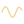 **Motion**
- GSAP timelines and ScrollTrigger
- Lenis smooth scrolling on fine pointers
- Variable-font weight ripple under the pointer
- Scroll-scrubbed manifesto, per-card parallax
- Everything pauses when off screen

</td>
<td width="50%" valign="top">

 **Engineering**
- Strict TypeScript 5.9, ES2023 target
- Tiny typed DOM toolkit instead of a framework
- Styling as inline style objects, no CSS files
- Reactive media state drives layout from code
- Vite 7 build, about 70 kB of JavaScript gzipped

</td>
</tr>
<tr>
<td width="50%" valign="top">

 **Art direction**
- Night-sky canvas with parallax stars and shooting stars
- Nebula that shifts to the active world colour
- Fraunces display type with optical and soft axes
- Film grain and vignette overlay
- One squircle icon family across the whole app

</td>
<td width="50%" valign="top">

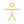 **Accessibility**
- Landmarks, labelled sections and real links
- Keyboard focus ring and carousel arrow keys
- Reduced motion removes splash, smoothing and loops
- Modified clicks open worlds in new tabs as expected

</td>
</tr>
</table>

---

<a id="the-six-worlds"></a>
##  The six worlds

Each world has a colour, a tone, a tagline and an icon with its own idle motion.

| Icon motif | World | Colour | Tagline | Idle motion |
|---|---|---|---|---|
| Glowing cell with orbit rings | **Noctiluca** | `#6fe3f2` | Find your way through the dark. | Rings counter-rotate, cell pulses |
| Flowing colour ribbons | **Aurora** | `#ffbd78` | Shape the cascade. | Ribbons follow a travelling sine wave |
| Dusk arch with brackets | **Vespera** | `#d8c18a` | Build the document. | Sun rises, brackets redraw |
| Constellation with a comet | **Stellara** | `#79a8ff` | Think in signals. | Comet travels the route, stars twinkle |
| Crescent moon and electrons | **Lunara** | `#d5a5ff` | Compose something alive. | Electrons orbit three ellipses |
| Eclipse with a corona | **Eclipsa** | `#8fdaa1` | Route the hidden world. | Corona turns and shimmers |

Worlds live in one array in `src/data/worlds.ts`. The home screen, orbit, carousel, footer and launch screen all read from it.

---

<a id="architecture"></a>
##  Architecture


The app is a thin core, a set of interface modules and a data layer.

**Boot.** `main.ts` applies the document styles, starts motion, builds each section, mounts the backdrop, tab bar and top bar, plays the launch screen if it has not run this session, and then plays the hero intro.

**Core.**
- `dom.ts` is the whole UI toolkit: `h()` builds elements from a props object, `s()` builds SVG, `css()` applies style maps, plus `splitChars`, `splitWords` and `onVisible`.
- `env.ts` exposes `desktop`, `reduced` and `fine` as reactive media state. Layout code subscribes with `env.watch` and re-applies styles on change.
- `motion.ts` registers GSAP and ScrollTrigger, starts Lenis on fine pointers and exposes `scrollTo` and `lock`.
- `state.ts` holds the **stage**, the world currently in the spotlight. The backdrop, orbit and carousel subscribe to it.
- `tokens.ts` holds colour, type and easing constants.

**Interface.** Each file in `src/ui` returns one element. Sections never import each other. They communicate through `stage`, through callbacks passed in from `main.ts`, or through the DOM.

**Styling without CSS.** Styles are inline style objects. The pieces CSS normally owns are handled in code: hover and press through pointer events, focus rings through a `:focus-visible` check, breakpoints through `matchMedia`, and keyframes through GSAP and the Web Animations timing it drives. One selection-colour rule is the only injected stylesheet.

---

<a id="app-icons"></a>
## 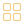 App icons

Icons are drawn in code, not exported from a design tool. `createIcon(id, { animate })` in `src/art/icons.ts` returns a handle:

```ts
const icon = createIcon('stellara', { animate: true })
host.append(icon.el)   // an SVG, 100 by 100 viewBox, scales to any size
icon.play()            // start the idle loop
icon.pause()           // stop it, for example when off screen
icon.destroy()         // kill the tweens and remove the node
```

- Every icon shares a **superellipse (n = 5) silhouette**, a soft top gloss and a thin inner rim, so the set reads as one family.
- Each scene is clipped to the silhouette, and drop shadows are applied as filters, so glows follow the real outline rather than a rounded box.
- Random details use a **seeded generator**, so every icon looks identical on every load.
- Animations are GSAP tweens created paused. `play` and `pause` are driven by `IntersectionObserver`, so only visible icons cost frames.
- Under reduced motion the icons render as still artwork.

The home-screen and install icons (`public/*.png`, `favicon.svg`, `og.png`) are generated by `npm run assets` from one vector definition. The glyph is sized inside the platform safe zone so no mask can clip it.

---

<a id="launch-flow"></a>
##  Launch flow

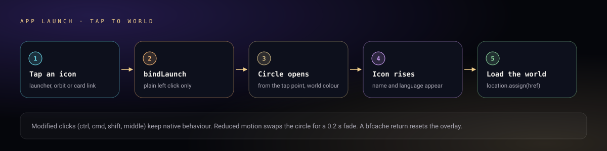

Every world link is a real anchor, so it works with a right click, a middle click or a long press. `bindLaunch` only takes over a plain left click. The overlay opens as a circle from the tap point in the world's colour, the icon rises with its name and language, and the browser then loads the world. Returning with the back button resets the overlay through the `pageshow` event.

| Interaction | Result |
|---|---|
| Tap a home screen icon | Launch the world |
| Tap an orbit icon | Scroll to that world's poster |
| Tap `Enter <World>` on a poster | Launch the world |
| Open `/#world-lunara` | Land on the Lunara poster |
| `Resume Python` button | Launch Noctiluca, shows solved count when known |

---

<a id="layout"></a>
##  Layout


Phone layout is the default. At 900 px and wider, `env.desktop` flips and every section re-applies its desktop styles.

| Part | Below 900 px | 900 px and up |
|---|---|---|
| Navigation | Glass tab bar at the bottom | Floating pill at the top |
| Hero | Stacked, title above the orbit | Two columns, orbit on the right |
| Home screen | Three columns, two rows | Six across |
| Carousel card | 82 vw, up to 366 px | 40 vw, up to 560 px |
| Carousel input | Swipe with snap | Drag, arrow buttons, arrow keys, hover tilt |
| Scrolling | Native momentum | Lenis smooth scrolling |
| Cursor | Not applicable | Default system cursor |

---

<a id="design-system"></a>
##  Design system


### Ink tokens

| Token | Value | Use |
|---|---|---|
| `void` | `#05060b` | Page background |
| `deep` | `#0a0c16` | Card base |
| `text` | `#f3f1ec` | Primary text |
| `soft` | `rgba(243,241,236,.66)` | Body copy |
| `faint` | `rgba(243,241,236,.38)` | Labels and hints |
| `line` | `rgba(243,241,236,.12)` | Borders |
| `glass` | `rgba(14,16,28,.58)` | Blurred panels, tab bar |
| `gold` | `#f2cf8b` | Brand accent, primary buttons |

### World colours

| World | Colour | Tone (card and nebula) |
|---|---|---|
| Noctiluca | `#6fe3f2` | `#0f4a63` |
| Aurora | `#ffbd78` | `#4a2548` |
| Vespera | `#d8c18a` | `#3b3358` |
| Stellara | `#79a8ff` | `#1b2b78` |
| Lunara | `#d5a5ff` | `#3b1c68` |
| Eclipsa | `#8fdaa1` | `#0e3d2e` |

### Typography

```
display  Fraunces Variable   titles, names, counters. opsz 144, SOFT 100, WONK 1, wght 200 to 760
body     Geist Variable      interface copy, 400 to 600
mono     Geist Mono          eyebrows, labels, notation, 0.2em tracking
```

Fonts are installed from `@fontsource` packages and bundled by Vite, so the page makes no font requests to third parties.

### Easing

```
expo.out         arrivals, titles, panels
power3.out       default for small moves
power3.inOut     curtains and launch circle
back.out(1.7)    pops, icon entrances
elastic.out      press release on buttons
```

---

<a id="motion"></a>
##  Motion


**Backdrop.** Two canvases. A low-resolution nebula, one fifth of the screen size, is repainted only when the active world changes colour. A star canvas draws 70 to 230 stars at up to 2x pixel density, parallaxed by scroll and pointer, with an occasional shooting star. A 160 px noise tile and a radial vignette sit on top. The loop pauses when the tab is hidden.

**Orbit.** Six icons sit exactly 60 degrees apart on one ellipse tilted by 6 degrees. Depth changes only scale and stacking, never position, so the formation stays even as it turns. Hovering any icon slows the whole orbit.

**Title.** Each letter of `Lumenari` is its own span. Near the pointer, the weight axis swells from 280 towards 760 with an eased falloff, then settles back. `System` shares one gradient across its letters, so colour flows along the word while the letters animate.

**Carousel.** Native scroll snap does the movement. A scroll handler then computes each card's distance from centre and sets its scale, opacity, rotation, icon parallax and numeral offset. The nearest card becomes the stage, which tints the sky.

**Reduced motion.** With `prefers-reduced-motion` the launch screen is skipped, Lenis is not started, stars stop twinkling and shooting, icons are still, and all entrances resolve instantly.

---

<a id="getting-started"></a>
## 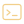 Getting started

**Prerequisites:** Node.js 22 or later, and npm.

```bash
git clone https://github.com/hassanireza/lumenari-system.git
cd lumenari-system
npm ci
npm run dev
```

Open the address Vite prints. The dev server hot-reloads on every save.

```bash
npm run dev        # start the dev server
npm run build      # tsc -b, then vite build into dist/
npm run preview    # serve the production build locally
npm run assets     # regenerate icons, favicon and social card into public/
```

The type check runs as part of the build, so a type error fails the deploy.

---

<a id="deployment"></a>
##  Deployment

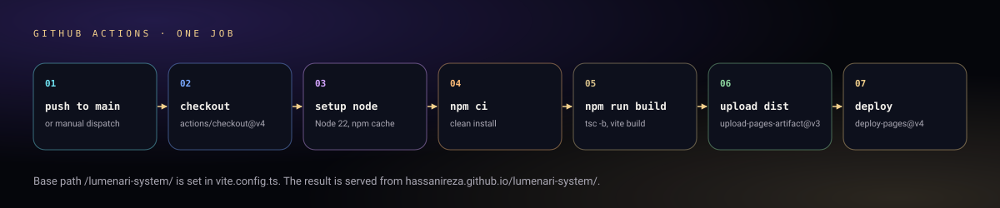

`.github/workflows/pages.yml` runs on every push to `main` and on manual dispatch:

1. Checks out the repo
2. Sets up Node 22 with npm caching
3. Runs `npm ci` for a clean install
4. Runs `npm run build`, which type-checks and bundles
5. Uploads `dist/` as the Pages artifact
6. Deploys it with `actions/deploy-pages`

The production base path is `/lumenari-system/`, set in `vite.config.ts`.

**To enable:** open **Settings, Pages, Build and deployment** and choose **GitHub Actions**.

---

##  Project structure

```
lumenari-system/
├── assets/                       README artwork (banner, diagrams, badges, icons)
├── public/
│   ├── favicon.svg               Tab icon
│   ├── apple-touch-icon.png      iOS home screen icon
│   ├── icon-192.png              Install icon
│   ├── icon-512.png              Install icon
│   ├── icon-maskable-512.png     Android adaptive icon
│   ├── og.png                    Social preview card
│   └── manifest.webmanifest      Web App Manifest
├── scripts/
│   └── generate-assets.mjs       Builds the public icons and social card
├── src/
│   ├── main.ts                   Boot, section assembly, splash and intro
│   ├── core/
│   │   ├── dom.ts                h(), s(), css(), splitChars, splitWords, onVisible
│   │   ├── env.ts                Reactive desktop, reduced and fine-pointer state
│   │   ├── motion.ts             GSAP, ScrollTrigger, Lenis, scrollTo, lock
│   │   ├── state.ts              The stage store (active world)
│   │   └── tokens.ts             Ink, fonts, variable-font axes, easing
│   ├── data/
│   │   └── worlds.ts             The six worlds and the Noctiluca progress reader
│   ├── art/
│   │   ├── icons.ts              Six procedural app icons
│   │   └── mark.ts               The Lumenari mark
│   └── ui/
│       ├── backdrop.ts           Nebula, stars, grain, vignette
│       ├── splash.ts             Launch screen
│       ├── topbar.ts             Brand and world count
│       ├── dock.ts               Tab bar and floating nav
│       ├── hero.ts               Title, copy and calls to action
│       ├── orrery.ts             The orbit of six icons
│       ├── launcher.ts           Home screen grid
│       ├── showcase.ts           Poster carousel
│       ├── method.ts             Manifesto and play loop
│       ├── footer.ts             Marquee, world links, colophon
│       ├── warp.ts               App-launch transition and bindLaunch
│       ├── fx.ts                 press, magnetic, tilt, arrow
│       └── parts.ts              Section heading and gutter helpers
├── .github/workflows/pages.yml   CI/CD to GitHub Pages
├── index.html                    Entry document
├── vite.config.ts                Vite config, base path
├── tsconfig.json                 Strict TypeScript options
└── package.json
```

---

##  Module reference

### `h()` and `s()`

```ts
const card = h('article', { style: { padding: '24px', borderRadius: '32px' }, attrs: { 'aria-label': 'Noctiluca' } },
  h('h3', { text: 'Noctiluca' }),
  h('a', { attrs: { href: world.href }, on: { click: onClick } }, 'Enter'))
```

`h` creates an element, applies a style map, attributes, data attributes, text and listeners, and appends children. Links and buttons automatically get a reset and a keyboard focus ring.

### `env`

```ts
env.desktop   // true at 900 px and wider
env.reduced   // prefers-reduced-motion
env.fine      // hover-capable mouse
env.watch(() => layout())   // runs now and on every change
```

### `stage`

```ts
stage.set(world)            // spotlight a world, or null for the neutral sky
stage.subscribe((w) => {})  // backdrop tint, orbit highlight
```

### `launch` and `bindLaunch`

```ts
bindLaunch(anchor, world)   // plain click opens the warp, modified clicks stay native
launch(world, { x, y })     // run the transition from a point
```

### `createShowcase()`

Returns `{ el, focus(id) }`. `focus` jumps the carousel to a world and scrolls the section into view.

---

##  Accessibility and platform

- Pages use `header`, `nav`, `main`, labelled `section` elements and a `footer`
- Every world is a real link, so it works with keyboard, long press and open in new tab
- Keyboard focus shows a gold ring. Pointer focus does not
- The carousel is a labelled group; left and right arrow keys move between worlds
- The tab bar marks the current section with `aria-current`
- Reduced motion switches off the launch screen, smooth scrolling and idle loops
- Primary actions are 52 px or taller, and the tab bar respects the home-bar safe area
- The manifest and icons support Add to Home Screen. There is no service worker, so a connection is required

---

##  Privacy and data

| What | Where | Why |
|---|---|---|
| Launch screen flag | `sessionStorage`, key `lumenari.splash` | Show the launch screen once per session |
| Noctiluca progress | `localStorage`, key `noctiluca.save.v1`, **read only** | Show the solved count when the games share an origin |
| Network requests | Links to the six worlds only | Fonts and code are bundled |

There is no analytics code, no cookies and no server of our own.

---

<a id="licenses"></a>
## 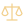 Licenses and credits

| Component | License | Notes |
|---|---|---|
| Application source | Not yet declared | Add a `LICENSE` file before accepting contributions |
| GSAP and ScrollTrigger | GSAP standard license | Free to use, see gsap.com/standard-license |
| Lenis | MIT | Smooth scrolling |
| Vite | MIT | Build tool |
| TypeScript | Apache-2.0 | Language and compiler |
| sharp | Apache-2.0 | Dev dependency for `npm run assets` |
| Fraunces, Geist, Geist Mono | SIL OFL 1.1 | Installed through `@fontsource` |

---

## 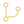 Contributing

1. Fork the repository
2. Create a branch: `git checkout -b feat/my-change`
3. Make your changes
4. Run `npm run build` and make sure it passes
5. Open a pull request against `main`

Guidelines:

- **Tokens first.** Take colour, type and easing from `core/tokens.ts` instead of hardcoding values in a section.
- **Styles in TypeScript.** Do not add stylesheets. Use style maps, `env.watch` for breakpoints and pointer events for interaction states.
- **Icons.** Draw on the 100 by 100 grid, clip to the shared squircle, seed any randomness, and create tweens paused so `play` and `pause` stay in control.
- **Adding a world.** Add its id to `WorldId` and an entry to `worlds` in `data/worlds.ts`, then add a scene to the `scenes` record in `art/icons.ts`. The orbit spaces icons by count. The home screen grid and tab bar assume six, so adjust `launcher.ts` if the count changes.
- **No em dashes.** Keep copy and comments free of them.
- **Respect reduced motion.** Anything that loops or moves on its own must check `env.reduced`.

---

<div align="center">

<br/>


</div>
